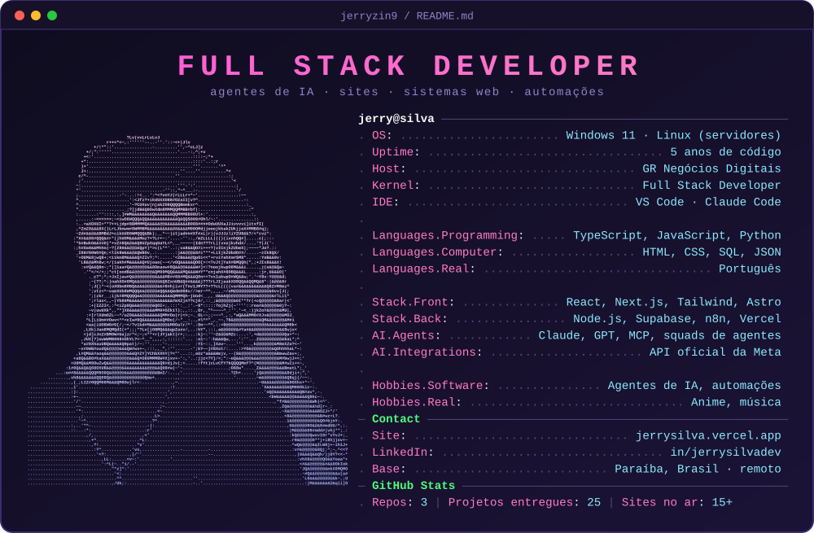
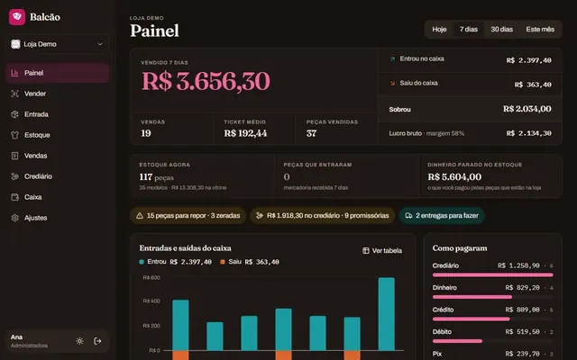
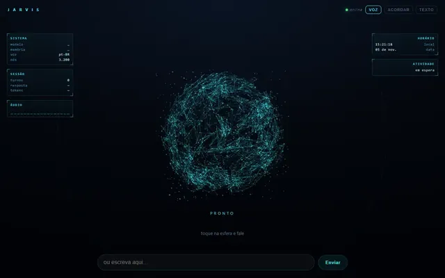
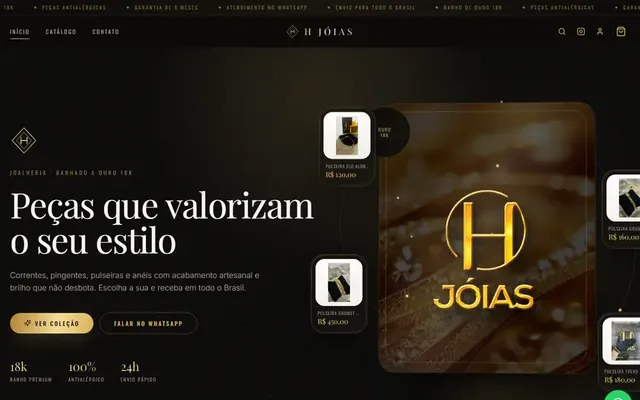
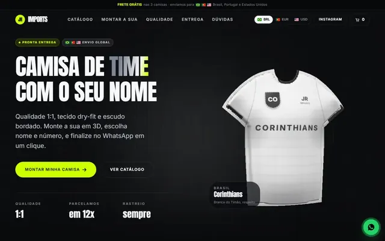
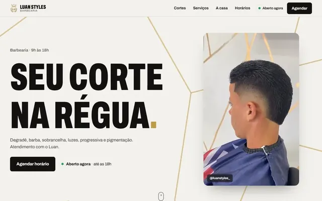
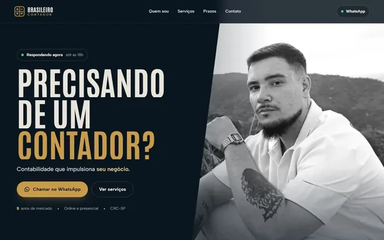

<a href="https://jerrysilva.vercel.app">
  <picture>
    <source media="(prefers-color-scheme: dark)" srcset="dark_mode.svg">
    <source media="(prefers-color-scheme: light)" srcset="light_mode.svg">
    
  </picture>
</a>

<p align="center">
  <a href="https://jerrysilva.vercel.app"></a>
  <a href="https://www.linkedin.com/in/jerrysilvadev"></a>
  <a href="https://wa.me/5583999670561?text=Ol%C3%A1%20Jerry%2C%20vim%20pelo%20seu%20GitHub"></a>
</p>

## `~/sobre`

Sou desenvolvedor full stack e trabalho com criação, estruturação e operação de **agentes de IA** em produção. Uno desenvolvimento, automação e inteligência artificial para transformar ideias em sites, sistemas e agentes que resolvem problemas reais, não só código bonito.

```bash
$ whoami --resumo
sites e landing pages · sistemas web · agentes de IA · automações · integrações
```

## `~/tools-and-technologies`

<p align="center">
  <picture>
    <source media="(prefers-color-scheme: light)" srcset="https://skillicons.dev/icons?i=react,nextjs,ts,js,nodejs,python,tailwind,html,css,astro,supabase,postgres,vercel,git,github,vscode&perline=8&theme=light">
    
  </picture>
</p>

<p align="center">
  
  
  
  
  
  
</p>

## `~/projetos --destaque`

<table>
  <tr><td align="center" width="33%"><a href="https://jerrysilva.vercel.app/#projetos"></a><br><b>Balcão</b><br><sub>Sistema de loja: estoque, venda no leitor de código de barras, caixa, crediário e etiquetas.</sub></td><td align="center" width="33%"><a href="https://jarvis-plum-delta.vercel.app"></a><br><b>Jarvis</b><br><sub>Assistente de voz com esfera 3D que reage enquanto ouve e responde.</sub></td><td align="center" width="33%"><a href="https://hjoias.store"></a><br><b>H Jóias</b><br><sub>Loja de joias com catálogo, carrinho e pedido no WhatsApp. Domínio próprio.</sub></td></tr>
  <tr><td align="center" width="33%"><a href="https://jr-imports.vercel.app"></a><br><b>JR Imports</b><br><sub>Loja de camisas de time: catálogo, camisa com nome e número e pedido no WhatsApp.</sub></td><td align="center" width="33%"><a href="https://luanstyles-previa.vercel.app"></a><br><b>Luan Styles</b><br><sub>Site de barbearia com status de aberto ao vivo, cortes reais e agendamento.</sub></td><td align="center" width="33%"><a href="https://brasileiro-contador.vercel.app"></a><br><b>Brasileiro Contador</b><br><sub>Site de contador com status ao vivo e contagem para o DAS.</sub></td></tr>
</table>

<details>
<summary><b>Ver os 25 projetos</b></summary>

| Projeto | Tipo | O que é | Link |
|---|---|---|---|
| **Balcão** | Sistema de loja | Estoque com grade de tamanhos, venda pelo leitor de código de barras ou pela câmera do celular, caixa, crediário com promissória, etiquetas para impressora térmica e painel do que vende e do que falta. | [Pedir demonstração](https://wa.me/5583999670561?text=Ol%C3%A1%20Jerry%2C%20quero%20ver%20uma%20demonstra%C3%A7%C3%A3o%20do%20Balc%C3%A3o) |
| **Jarvis** | Assistente de IA | Assistente pessoal com interface de voz: você fala, a esfera 3D reage e ele responde em áudio, em português. Faz parte do squad Hermes. | [abrir](https://jarvis-plum-delta.vercel.app) |
| **Supersquad** | Plataforma | Plataforma de squads de agentes de IA: automação, produtividade e operação inteligente para times e empresas. | [Saber mais](https://wa.me/5583999670561?text=Quero%20saber%20mais%20sobre%20o%20Supersquad) |
| **Hermes** | Orquestração | Motor de execução e orquestração de agentes, crons, tarefas e rotinas automáticas. | [Saber mais](https://wa.me/5583999670561?text=Quero%20saber%20mais%20sobre%20o%20Hermes) |
| **OpenClaw** | Governança de IA | Ambiente de criação e governança de agentes, skills, workspaces e estrutura operacional de IA. | [Saber mais](https://wa.me/5583999670561?text=Quero%20saber%20mais%20sobre%20o%20OpenClaw) |
| **Squad de Vídeo com IA** | Squad | Squad de criação de vídeo: linha editorial, tendências, roteiros, avatares e conteúdo para Reels, TikTok e Shorts. | [Saber mais](https://wa.me/5583999670561?text=Quero%20saber%20mais%20sobre%20o%20Squad%20de%20V%C3%ADdeo) |
| **Squad Funil de Vendas** | Squad | Squad focado em leads, atendimento, automação comercial, pipeline organizado e conversão de clientes. | [Saber mais](https://wa.me/5583999670561?text=Quero%20saber%20mais%20sobre%20o%20Squad%20de%20Vendas) |
| **Atendimento com IA no WhatsApp** | Automação | Atendimento automático no WhatsApp com triagem por IA e painel web para o escritório Ronzinério Oliveira. | [Quero um assim](https://wa.me/5583999670561?text=Quero%20um%20atendimento%20com%20IA%20no%20WhatsApp%20como%20o%20do%20Ronzin%C3%A9rio) |
| **Cérebro de Conteúdo** | IA de conteúdo | Metodologia e sistema de IA sob medida para modelar conteúdos virais e escalar perfis a partir do que o mercado já aprovou. | [Saber mais](https://wa.me/5583999670561?text=Quero%20saber%20mais%20sobre%20o%20C%C3%A9rebro%20de%20Conte%C3%BAdo) |
| **H Jóias** | Loja virtual | Vitrine de joias banhadas a ouro 18k com catálogo, carrinho e pedido finalizado no WhatsApp. Domínio próprio. | [abrir](https://hjoias.store) |
| **JR Imports** | Loja virtual | Loja de camisas de time importadas: catálogo por seleção e clube, camisa com nome e número e pedido direto no WhatsApp. | [abrir](https://jr-imports.vercel.app) |
| **Cria e Recria** | Ateliê | Site de ateliê de papelaria personalizada com catálogo de produtos, galeria e orçamento no WhatsApp. | [abrir](https://cria-e-recria.vercel.app/a/) |
| **Paula Cristina** | Autoridade · domínio próprio | Site de autoridade para escritora cristã e teóloga: livros, blog, cursos, palestras e agenda. | [abrir](https://www.paulacristinafigueiredo.com.br) |
| **Fernando Irineu** | Portal · domínio próprio | Portal de materiais, mentorias e blog para profissional de políticas públicas no SUAS e no Programa Criança Feliz. | [abrir](https://visita-feliz-materiais.vercel.app) |
| **Gabriela Otaviano** | Educação | Plataforma de materiais e cursos de educação infantil, inclusão e psicopedagogia. | [abrir](https://gabriela-creche-bloom.vercel.app) |
| **Luz Consultoria** | Institucional | Site de consultoria empresarial com soluções, método, resultados, carreiras e tema claro/escuro. | [abrir](https://luz-consultoria.vercel.app) |
| **OtakuBlog** | Blog | Portal de cultura otaku com reviews, notícias e rankings, construído em Astro para carregar rápido. | [abrir](https://otakublog-opal.vercel.app) |
| **Brasileiro Contador** | Site profissional | Site de contador com status de atendimento ao vivo, contagem para o vencimento do DAS e mensagem pronta no WhatsApp. | [abrir](https://brasileiro-contador.vercel.app) |
| **Luan Styles** | Barbearia | Site de barbearia com status de aberto ou fechado ao vivo, cortes reais do Instagram, serviços e agendamento que manda o pedido pronto no WhatsApp. | [abrir](https://luanstyles-previa.vercel.app) |
| **Barbearia Hope** | Barbearia | Site da primeira barbearia por assinatura de São José de Piranhas (PB): horário ao vivo com os dois turnos, assinatura, curso de barbeiro e agendamento. | [abrir](https://hope-previa.vercel.app) |
| **Ronzinério Oliveira** | Advocacia | Landing page de advocacia com áreas de atuação, autoridade e captação de casos pelo WhatsApp. | [abrir](https://ronzinerio-landing.vercel.app) |
| **XBASE · Oferta-relâmpago** | Campanha | Página de campanha da XBASE: o primeiro robô de IA no WhatsApp oficial da empresa, com preço promocional e contagem regressiva. | [abrir](https://xbase-oferta.vercel.app) |
| **XBASE · Live do agente** | Inscrição em live | Página da live em que o cliente monta, com o time da XBASE, o agente de IA do próprio WhatsApp. | [abrir](https://xbase-live-agente.vercel.app) |
| **A Triunidade de Deus** | Lançamento de livro | Landing page de lançamento de livro com storytelling, pilares da obra, prova social e três temas visuais. | [abrir](https://triunidade-de-deus.vercel.app) |
| **Camilly França** | Portfólio | Portfólio editorial para fotógrafa em São Paulo: galeria, serviços e orçamento direto pelo WhatsApp. | [abrir](https://camilly-franca-portfolio.vercel.app) |

</details>

## `~/contato`

Precisa de um site, sistema, automação ou agente de IA para o seu negócio? Me manda uma mensagem, respondo rápido.

<p>
  <a href="https://wa.me/5583999670561?text=Ol%C3%A1%20Jerry%2C%20quero%20falar%20sobre%20um%20projeto"></a>
  <a href="https://jerrysilva.vercel.app"></a>
</p>
