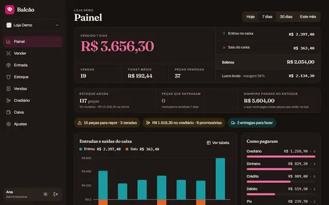
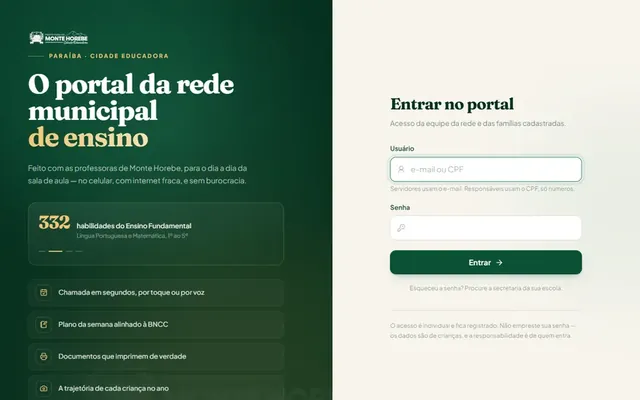
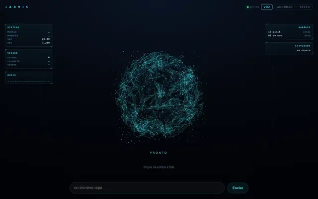
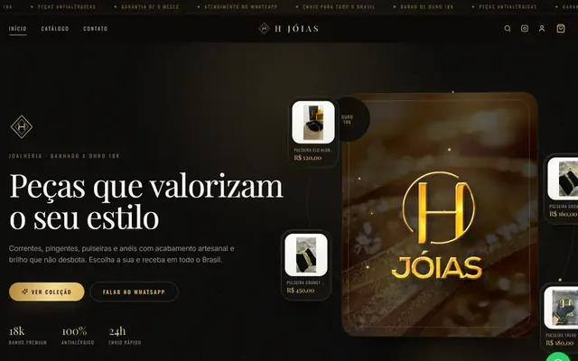
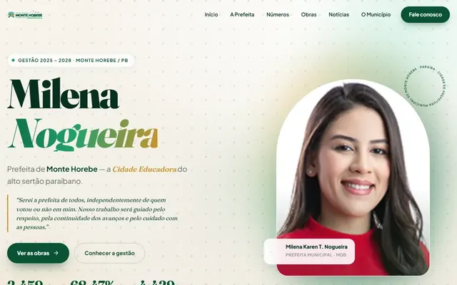

  

  
  
  

## 暁 Sobre mim

Sou desenvolvedor fullstack e trabalho com criação, estruturação e operação de **squads de agentes de IA**. Uno desenvolvimento, automação e inteligência artificial para transformar ideias em sistemas, agentes e produtos digitais que resolvem problemas reais, e não só código bonito.

  
  
  
  
  

## 弐 O que eu faço

| 創 **Desenvolvimento Fullstack** | 智 **Agentes de IA** | 速 **Automações** |
|---|---|---|
| Sites, aplicações web, sistemas, dashboards e integrações de ponta a ponta. | Agentes que executam tarefas, analisam dados e apoiam vendas, marketing e operação. | Fluxos automáticos que reduzem trabalho manual e organizam processos. |
| 群 **Squads de IA** | 映 **Marketing & Conteúdo com IA** | 繋 **Integrações** |
| Agentes especializados para DevOps, vendas, marketing, vídeo, conteúdo e atendimento. | Estratégia, roteiros, linha editorial, tendências e conteúdo para redes sociais. | Ferramentas, APIs, sistemas e plataformas em um único fluxo. |

## 参 Missões em destaque

<table>
  <tr><td align="center" width="33%"> <b>Balcão</b> · <code>rank&nbsp;S</code> Sistema de loja: estoque, venda no leitor de código de barras, caixa, crediário e etiquetas.</td><td align="center" width="33%"> <b>Portal Escolar de Monte Horebe</b> · <code>rank&nbsp;S</code> Plataforma da rede municipal: chamada, planos de aula na BNCC e documentos.</td><td align="center" width="33%"> <b>Jarvis</b> · <code>rank&nbsp;S</code> Assistente de voz com esfera 3D que reage enquanto ouve e responde.</td></tr>
  <tr><td align="center" width="33%"> <b>H Jóias</b> · <code>rank&nbsp;A</code> Loja de joias com catálogo, carrinho e pedido no WhatsApp. Domínio próprio.</td><td align="center" width="33%"> <b>Milena Nogueira</b> · <code>rank&nbsp;A</code> Portal da gestão municipal: obras, notícias, secretarias e números.</td><td align="center" width="33%"> <b>Brasileiro Contador</b> · <code>rank&nbsp;B</code> Site de contador com status ao vivo e contagem para o DAS.</td></tr>
</table>

<b>Ver as 25 missões</b> (rank S: sistemas e IA · A: lojas e portais · B: sites e landing pages)

| Rank | Missão | Tipo | O que é | Link |
|:---:|---|---|---|---|
| `S` | **Balcão** | Sistema de loja | Estoque com grade de tamanhos, venda pelo leitor de código de barras ou pela câmera do celular, caixa, crediário com promissória, etiquetas para impressora térmica e painel do que vende e do que falta. | [Pedir demonstração](https://wa.me/5583999670561?text=Ol%C3%A1%20Jerry%2C%20quero%20ver%20uma%20demonstra%C3%A7%C3%A3o%20do%20Balc%C3%A3o) |
| `S` | **Portal Escolar de Monte Horebe** | Plataforma | Plataforma da rede municipal de ensino: chamada, planos de aula alinhados à BNCC, documentos e acompanhamento do desenvolvimento dos alunos. | [abrir](https://portal-escolar-monte-horebe.vercel.app) |
| `S` | **Jarvis** | Assistente de IA | Assistente pessoal com interface de voz: você fala, a esfera 3D reage e ele responde em áudio, em português. Faz parte do squad Hermes. | [abrir](https://jarvis-plum-delta.vercel.app) |
| `S` | **Supersquad** | Plataforma | Plataforma de squads de agentes de IA: automação, produtividade e operação inteligente para times e empresas. | [Saber mais](https://wa.me/5583999670561?text=Quero%20saber%20mais%20sobre%20o%20Supersquad) |
| `S` | **Hermes** | Orquestração | Motor de execução e orquestração de agentes, crons, tarefas e rotinas automáticas. | [Saber mais](https://wa.me/5583999670561?text=Quero%20saber%20mais%20sobre%20o%20Hermes) |
| `S` | **OpenClaw** | Governança de IA | Ambiente de criação e governança de agentes, skills, workspaces e estrutura operacional de IA. | [Saber mais](https://wa.me/5583999670561?text=Quero%20saber%20mais%20sobre%20o%20OpenClaw) |
| `S` | **Squad de Vídeo com IA** | Squad | Squad de criação de vídeo: linha editorial, tendências, roteiros, avatares e conteúdo para Reels, TikTok e Shorts. | [Saber mais](https://wa.me/5583999670561?text=Quero%20saber%20mais%20sobre%20o%20Squad%20de%20V%C3%ADdeo) |
| `S` | **Squad Funil de Vendas** | Squad | Squad focado em leads, atendimento, automação comercial, pipeline organizado e conversão de clientes. | [Saber mais](https://wa.me/5583999670561?text=Quero%20saber%20mais%20sobre%20o%20Squad%20de%20Vendas) |
| `S` | **Atendimento com IA no WhatsApp** | Automação | Atendimento automático no WhatsApp com triagem por IA e painel web para o escritório Ronzinério Oliveira. | [Quero um assim](https://wa.me/5583999670561?text=Quero%20um%20atendimento%20com%20IA%20no%20WhatsApp%20como%20o%20do%20Ronzin%C3%A9rio) |
| `S` | **Cérebro de Conteúdo** | IA de conteúdo | Metodologia e sistema de IA sob medida para modelar conteúdos virais e escalar perfis a partir do que o mercado já aprovou. | [Saber mais](https://wa.me/5583999670561?text=Quero%20saber%20mais%20sobre%20o%20C%C3%A9rebro%20de%20Conte%C3%BAdo) |
| `A` | **H Jóias** | Loja virtual | Vitrine de joias banhadas a ouro 18k com catálogo, carrinho e pedido finalizado no WhatsApp. Domínio próprio. | [abrir](https://hjoias.store) |
| `A` | **JR Imports** | Loja virtual | Loja de camisas de time importadas: catálogo por seleção e clube, camisa com nome e número e pedido direto no WhatsApp. | [abrir](https://jr-imports.vercel.app) |
| `A` | **Cria e Recria** | Ateliê | Site de ateliê de papelaria personalizada com catálogo de produtos, galeria e orçamento no WhatsApp. | [abrir](https://cria-e-recria.vercel.app/a/) |
| `A` | **Milena Nogueira** | Portal de gestão pública | Portal da gestão da prefeita de Monte Horebe (PB): obras, notícias, secretarias, números da gestão e serviços da Cidade Educadora. | [abrir](https://milena-nogueira.vercel.app) |
| `A` | **Paula Cristina** | Autoridade · domínio próprio | Site de autoridade para escritora cristã e teóloga: livros, blog, cursos, palestras e agenda. | [abrir](https://www.paulacristinafigueiredo.com.br) |
| `A` | **Fernando Irineu** | Portal · domínio próprio | Portal de materiais, mentorias e blog para profissional de políticas públicas no SUAS e no Programa Criança Feliz. | [abrir](https://visita-feliz-materiais.vercel.app) |
| `A` | **Gabriela Otaviano** | Educação | Plataforma de materiais e cursos de educação infantil, inclusão e psicopedagogia. | [abrir](https://gabriela-creche-bloom.vercel.app) |
| `A` | **Luz Consultoria** | Institucional | Site de consultoria empresarial com soluções, método, resultados, carreiras e tema claro/escuro. | [abrir](https://luz-consultoria.vercel.app) |
| `A` | **OtakuBlog** | Blog | Portal de cultura otaku com reviews, notícias e rankings, construído em Astro para carregar rápido. | [abrir](https://otakublog-opal.vercel.app) |
| `B` | **Brasileiro Contador** | Site profissional | Site de contador com status de atendimento ao vivo, contagem para o vencimento do DAS e mensagem pronta no WhatsApp. | [abrir](https://brasileiro-contador.vercel.app) |
| `B` | **Ronzinério Oliveira** | Advocacia | Landing page de advocacia com áreas de atuação, autoridade e captação de casos pelo WhatsApp. | [abrir](https://ronzinerio-landing.vercel.app) |
| `B` | **XBASE · Oferta-relâmpago** | Campanha | Página de campanha da XBASE: o primeiro robô de IA no WhatsApp oficial da empresa, com preço promocional e contagem regressiva. | [abrir](https://xbase-oferta.vercel.app) |
| `B` | **XBASE · Live do agente** | Inscrição em live | Página da live em que o cliente monta, com o time da XBASE, o agente de IA do próprio WhatsApp. | [abrir](https://xbase-live-agente.vercel.app) |
| `B` | **A Triunidade de Deus** | Lançamento de livro | Landing page de lançamento de livro com storytelling, pilares da obra, prova social e três temas visuais. | [abrir](https://triunidade-de-deus.vercel.app) |
| `B` | **Camilly França** | Portfólio | Portfólio editorial para fotógrafa em São Paulo: galeria, serviços e orçamento direto pelo WhatsApp. | [abrir](https://camilly-franca-portfolio.vercel.app) |

## 肆 Arsenal

  

  
  
  
  
  
  

## 伍 Os seis selos (como eu trabalho)

`子` Entendo o problema → `丑` Organizo a solução → `寅` Crio a estrutura técnica → `卯` Automatizo o processo → `辰` Testo e melhoro → `巳` Entrego algo prático

## 陸 Vamos criar algo inteligente juntos?

Se você precisa de um site, sistema, automação ou agente de IA para organizar melhor o seu negócio, me chama. Respondo rápido.

  
  

暁 · Jerry Silva · desenvolvedor fullstack, IA e automação

